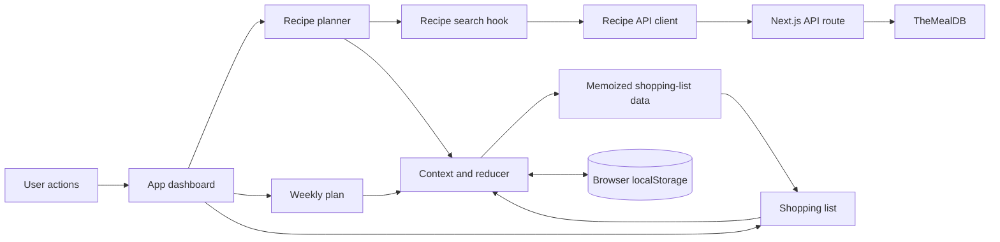

# Gather

**A weekly meal planner that turns recipes into a practical shopping list.**

Gather helps people decide what to cook, keep recipes and ingredients together, and shop with a clear list. It is a responsive Next.js app built around an everyday workflow: discover or create a dish, plan the week, then shop from the ingredients that meal needs.

## Explore the app

1. Search TheMealDB or create a personal recipe with ingredients and optional preparation notes.
2. Choose a day and meal slot, then add the recipe to the weekly plan.
3. Open any recipe to read the complete preparation steps, ingredient amounts, and available source or video link.
4. Shop from the combined ingredient list or switch to a meal-by-meal view. Search, filter, check off, or remove items as you go.
5. Save favorite recipes, personalize your space, and switch between light and dark themes.

New plans start empty. **Try sample week** is an optional, one-click demo that adds four editable meals and their ingredients, so visitors can explore the complete flow without entering data first.

## Features

- Weekly meal planning for breakfast, lunch, and dinner, with week navigation and a mobile day selector.
- Recipe search and detail lookup through a same-origin Next.js API route.
- Custom recipes with ingredient amounts and optional preparation steps.
- Recipe favorites and full recipe details from both recipe cards and planned meals.
- Shopping list grouped by ingredient or by meal, with quantity summaries where units are compatible.
- Needed/in-basket filters, ingredient search, custom grocery entry, and per-item removal.
- Browser persistence, including migration from the earlier shopping-list storage format.
- Responsive desktop and mobile layouts, keyboard-operable controls, accessible labels, and light/dark themes.
- Optional sample-week data that demonstrates the product without adding defaults to a new user's plan.

## Architecture



The dashboard coordinates the feature views. Shared meal and grocery state lives in a React Context reducer; stable actions let each view update the same plan without keeping duplicate copies. Shopping groups and counts are derived and memoized from that state. Recipe search, API access, recipe normalization, and recipe presentation are kept in separate modules so API results and user-created recipes use a common shape.

## Tech stack

| Area | Technology |
| --- | --- |
| Application | Next.js App Router, React |
| Styling | Tailwind CSS, CSS custom-property design tokens |
| Shared state | React Context and `useReducer` |
| Recipe data | TheMealDB through a Next.js route handler |
| Persistence | Browser `localStorage` |
| Deployment | Netlify with GitHub-connected builds |

## Project structure

```text
app/
  api/recipes/          Recipe search and detail lookup proxy
  layout.js             Root layout, theme initialization, and metadata
  page.js               Dashboard state coordination and view selection
features/
  dashboard/            Navigation, dialogs, and personal preferences
  meal-planning/        Weekly plan, day cards, shopping list, demo data, and hooks
  recipes/              API client, search hook, normalization, details, and forms
  shopping/             Shared reducer, stable actions, and browser persistence
```

## Run locally

```bash
npm install
npm run dev
```

Open [http://localhost:3000](http://localhost:3000). Recipe search and detail lookup need an internet connection. The sample week and custom recipes work without a recipe-service response. No API key or environment variables are required.

## Quality checks

```bash
npm run lint
npm run build
npm start
```

## Deploying on Netlify

Connect the existing GitHub repository to the Netlify site and deploy the branch you want to publish. Netlify detects Next.js and supports the App Router and route handlers through its Next.js adapter. If the build settings need to be entered manually, use `npm run build` as the build command and `.next` as the publish directory. No application environment variables are required. See [Netlify's Next.js setup guide](https://docs.netlify.com/build/frameworks/framework-setup-guides/nextjs/overview/) for current platform details.

## Current scope and tradeoffs

Gather is a single-browser portfolio app: it has no accounts, cross-device household sync, or server-side database. Plans and preferences stay in the current browser. Recipe search and detail lookup depend on TheMealDB availability. Ingredient amounts are preserved and compatible simple amounts can be totalled, but arbitrary units and pack sizes are not converted or inferred.

The next product-sized improvements would be automated interaction and quantity tests, user-controlled servings with ingredient scaling, and shared household sync.
